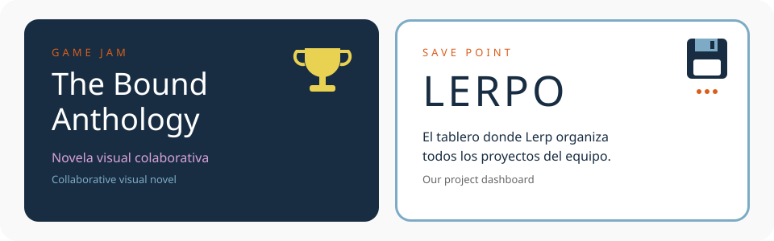

<div align="center">

<a href="https://eloadev.github.io/proyects/">
  
</a>


<a href="https://eloadev.github.io/proyects/"></a>
<a href="https://www.instagram.com/eloadevteam"></a>


<a href="https://eloadev.github.io/proyects/party-problems/inicioParty"></a>
<a href="https://eloadev.github.io/proyects/parabolic-pets/inicioPets"></a>
<a href="https://eloadev.github.io/proyects/Weavy/inicioWeavy"></a>
<a href="https://eloadev.github.io/proyects/Calculadoras/calculadoras"></a>
<a href="https://eloadev.github.io/proyects/Coordenadas/graficar"></a>
<a href="https://eloadev.github.io/proyects/protocol-entropy/inicioProtocol"></a>

<sub>Haz clic en cualquier nivel para jugarlo · <i>Click any level to play</i></sub>


<a href="https://eloadev.github.io/proyects/gamejams/BoundAnthology/inicioBound"></a>

<a href="https://eloadev.github.io/proyects/gamejams/BoundAnthology/inicioBound"></a>
<a href="https://eloadev.github.io/lerpo/#/"></a>


<br>


<a href="https://github.com/eloadev"></a>


<sub>🐍 La viborita se come nuestros commits · <i>the snake eats our commits</i></sub>

<details>
<summary><b>⬆️ ⬆️ ⬇️ ⬇️ ⬅️ ➡️ ⬅️ ➡️ 🅱️ 🅰️</b></summary>
<br>


<h3>🎉 ¡CÓDIGO SECRETO ACTIVADO! · SECRET CODE UNLOCKED!</h3>

**+30 VIDAS** · Lerp tiene una idea 💡<br>
Hay niveles nuevos en *Trabajo en progreso*… pero todavía no podemos decir nada 🤫<br>
<sub><i>New levels are cooking. Stay tuned.</i></sub>

```text
> ¿Sabías que "lerp" es como los gamedevs le dicen
  a la interpolación lineal? ¿Coincidencia? 👀
```

</details>


<a href="https://www.instagram.com/eloadevteam"></a>
<a href="mailto:eloadevteam@gmail.com"></a>
<a href="https://eloadev.github.io/proyects/"></a>

<a href="https://eloadev.github.io/proyects/"></a>

</div>
